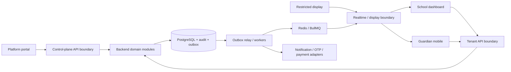

# HomeBell architecture

Status: Phase 0 blueprint, documented 2026-10-07. The approved Phase 1 subset is now implemented and verified locally; see [PHASE_1_REPORT.md](PHASE_1_REPORT.md). Later application/worker boundaries below remain planned, not implemented. Open decisions in [PHASE_PLAN.md](PHASE_PLAN.md) remain open until their recorded gates are satisfied.

## Sources and scope

[PRODUCT_REQUIREMENTS.md](PRODUCT_REQUIREMENTS.md) contains the frozen product rules. [../CLAUDE.md](../CLAUDE.md) defines the engineering contract. These documents take precedence over this blueprint. No runtime code, migrations, external accounts, infrastructure, or paid services are created by Phase 0.

HomeBell coordinates dismissal; guardian acknowledgment is not physical identity verification. MVP excludes scanning, audio, automatic refunds, a full iOS release, advanced bus management, and AI analytics.

## Decisions

| Area | Decision | Reason / boundary |
|---|---|---|
| Backend | NestJS, TypeScript, supported Node.js LTS | Modular services with explicit authorization and transaction boundaries |
| Durable state | PostgreSQL | Transactions, relational constraints, and tenant isolation |
| Coordination | Redis | Distributed rate limits and realtime fanout; never the only business record |
| Jobs | BullMQ | Retryable secondary work in separately deployed workers |
| Web | Next.js, React, TypeScript | Separate platform, school, and display applications |
| Mobile | React Native, TypeScript, Android first | Share contracts while isolating native secure storage and notifications |
| Push | FCM through an internal port | Replaceable provider; push is a hint to fetch authoritative state |
| Workspace | pnpm workspaces | One lockfile and explicit package dependencies |
| Realtime | Socket.IO with Redis adapter | Authenticated fanout plus application-level snapshot recovery |
| Architecture | Modular monolith plus worker processes | Keep operations practical and preserve future extraction boundaries |

Exact supported dependency versions and the data-access library are selected and pinned during the Phase 1 proposal. The library must pass transaction-local RLS, migration, composite-key, and concurrency checks before adoption. No package installation is authorized by this document alone.

## Proposed structure

```text
apps/
  api/                 # identity, tenancy, school, guardians, dismissal,
                       # subscriptions, entitlements, audit, notifications
  worker/              # outbox relay, notification, report, expiry jobs
  platform-admin/      # platform control plane
  school-web/          # school operations
  display/             # restricted public-screen projection
  mobile/              # guardian Android app; platform adapters for iOS later
packages/
  api-contracts/       # public DTOs and event envelopes, never ORM models
  validation/         # reusable input schemas; backend remains authoritative
  config/             # validated configuration definitions
  observability/      # logging, redaction, trace context
  security/           # infrastructure helpers, not client-enforced policies
  ui/                 # web-only shared components
  testing/            # deterministic fixtures and test helpers
docs/
```

Backend domain modules own business policies and repositories. Controllers call application services; application services authorize and orchestrate transactions; repositories require explicit trusted context. Module interactions use exported service interfaces and domain events. Clients cannot import backend persistence code. Avoid creating empty packages until an actual consumer exists.



Arrows describe trust and data flow, not unrestricted permissions. OTP and payment calls occur through bounded application workflows; they are not necessarily queued with dismissal notifications.

## Application experiences

**Platform portal:** tenant search/list, tenant detail, subscription and versioned plan assignment, lifecycle actions, expiring grants, usage/limits, internal notes, and audit retrieval. Require reason and deliberate confirmation for privileged changes. Expose manual refund notes only. Platform users do not inherit school permissions. Tenant impersonation is deferred.

**School dashboard:** overview counts; students/classes/sections; guardian relationships, validity and blocking; staff/roles; dismissal windows and optional location policy; queue/search; unresolved cases; history and reports; display enrollment. Device-transfer visibility is operational metadata, not access to session secrets.

**Guardian app:** OTP onboarding; child list; request and confirm pickup; live status/history; invite/purchase management; device transfer-or-buy; blocked/expired states; notification and account settings. Large actions show pending, confirmed, failed, and stale states distinctly. A timeout is an unknown outcome until reconciled. Do not queue a time-sensitive pickup for unattended submission after a long offline interval.

**Display:** school-enrolled, read-only credential tied to one tenant and projection. Show pickup alias, ordering, and coarse dismissal status. Do not send full student or guardian objects and hide fields only in CSS. Enrollment/credential revocation is described in [AUTH_AND_RBAC.md](AUTH_AND_RBAC.md).

## Deployment and operations

Start with containers for API/realtime and workers behind TLS ingress, managed PostgreSQL with backups/PITR, and managed Redis. Web applications deploy independently with separate session audiences and origins. Use separate production and nonproduction credentials and datasets. Use local container services during development; the exact container tool is chosen during Phase 1 setup.

Redis job storage must have an appropriate persistence/no-eviction policy; use a separate cache instance if cache eviction or load would endanger jobs. PostgreSQL outbox reconciliation permits recovery from lost queue entries. Scale API connections, workers, and database pools against a measured dismissal load model. Hosting region, availability objectives, retention, and recovery targets are unresolved release gates, not assumed commitments.

Secrets come from deployment secret management; local examples contain names/placeholders only. Validate configuration at startup. Deploy backward-compatible API and schema changes first, then clients and workers; use expand/backfill/contract migrations. Mobile clients may remain old for long periods, so breaking changes require a versioned compatibility plan.

## Future extensions

Keep campus ownership in the domain, notification provider interfaces, versioned event contracts, and platform-specific mobile adapters. Future audio/QR can consume explicit dismissal events behind approved capabilities. They must not change what MVP acknowledgment means. Enterprise isolation can route a tenant to another database through a future trusted placement registry; no database-per-tenant provisioning is implemented now.

## Blueprint map

- [DOMAIN_MODEL.md](DOMAIN_MODEL.md): ownership, aggregates, state machines.
- [DATABASE.md](DATABASE.md): constraints, transactions, migrations.
- [MULTITENANCY.md](MULTITENANCY.md): trust boundaries and RLS.
- [AUTH_AND_RBAC.md](AUTH_AND_RBAC.md): sessions, OTP, roles, devices.
- [ENTITLEMENTS.md](ENTITLEMENTS.md): subscriptions, licensing, lifecycle.
- [API_STANDARDS.md](API_STANDARDS.md): proposed contracts and errors.
- [REALTIME.md](REALTIME.md): delivery, recovery, worker behavior.
- [SECURITY.md](SECURITY.md): threats, controls, release gates.
- [OBSERVABILITY.md](OBSERVABILITY.md): logs, audits, metrics, tracing.
- [TESTING.md](TESTING.md): verification and release requirements.
- [PHASE_PLAN.md](PHASE_PLAN.md): dependencies, decisions, approval gates.

## Phase 2 implementation (2026-10-08)

The owner application now lives in `apps/platform-admin` (Next.js App Router). Its route handler proxies only `/api/v1/platform/*` and `/api/v1/platform-auth/*` to a fixed backend. The browser renders operational views; all authentication, authorization, grants and lifecycle rules execute in NestJS. Focused backend services are `Plans`, `AccessManagement`, `ControlQueries` and `ControlWork`. School/mobile applications and outbox delivery workers remain future work.

See [PHASE_2_REPORT.md](PHASE_2_REPORT.md) for verification and remaining production gates.

